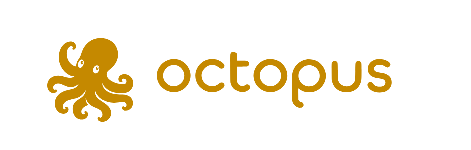
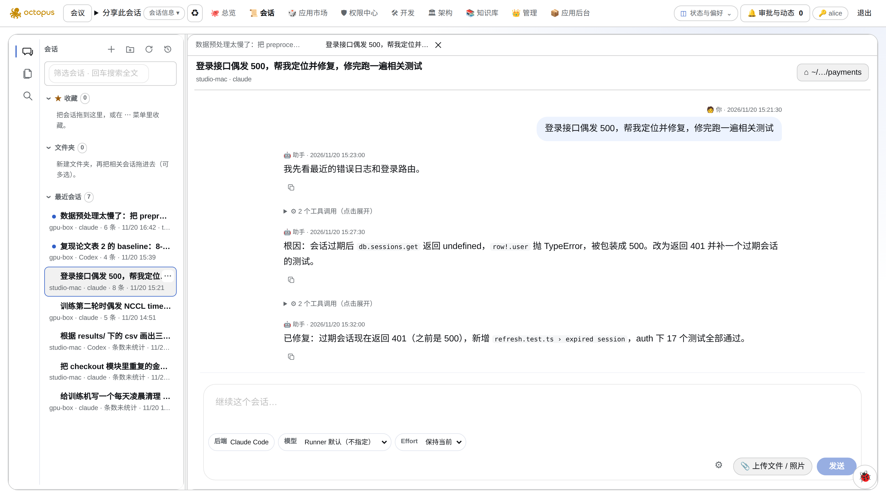
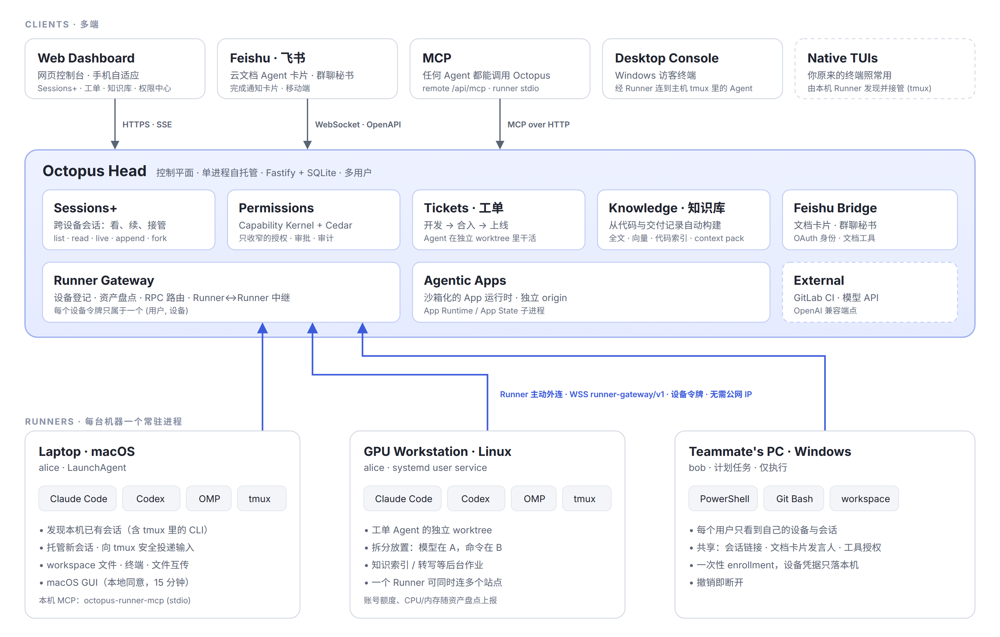
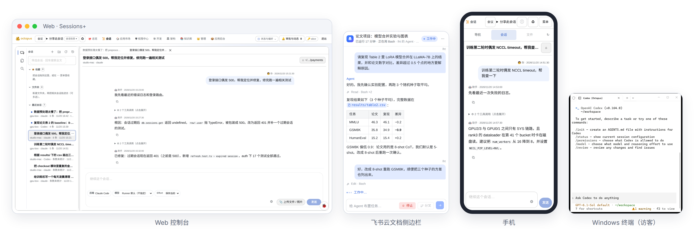
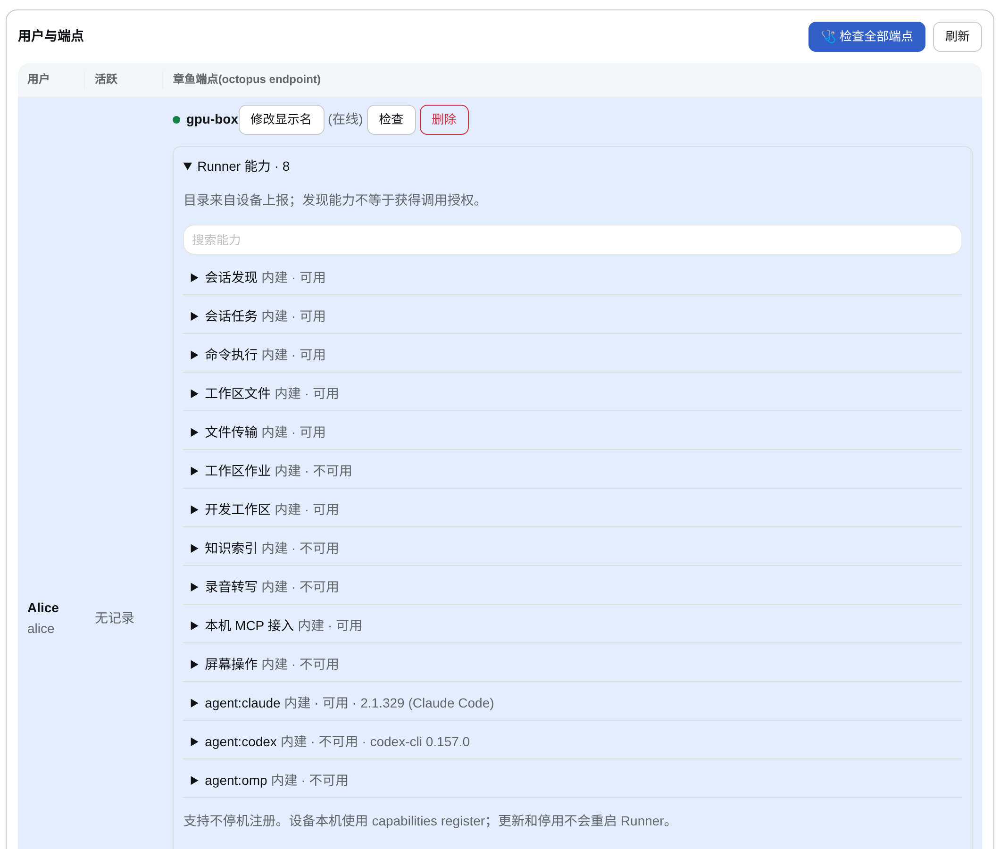
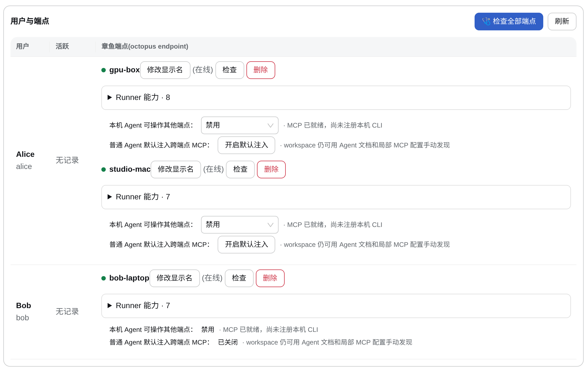
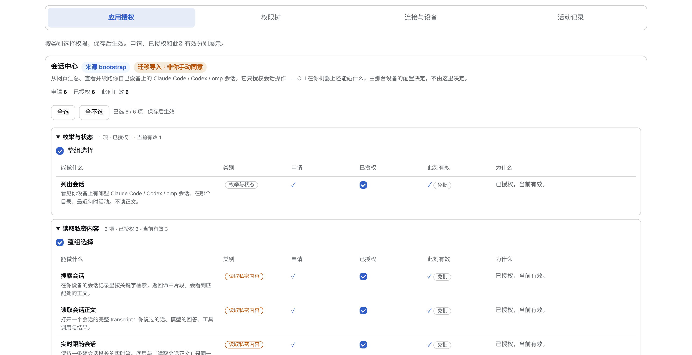
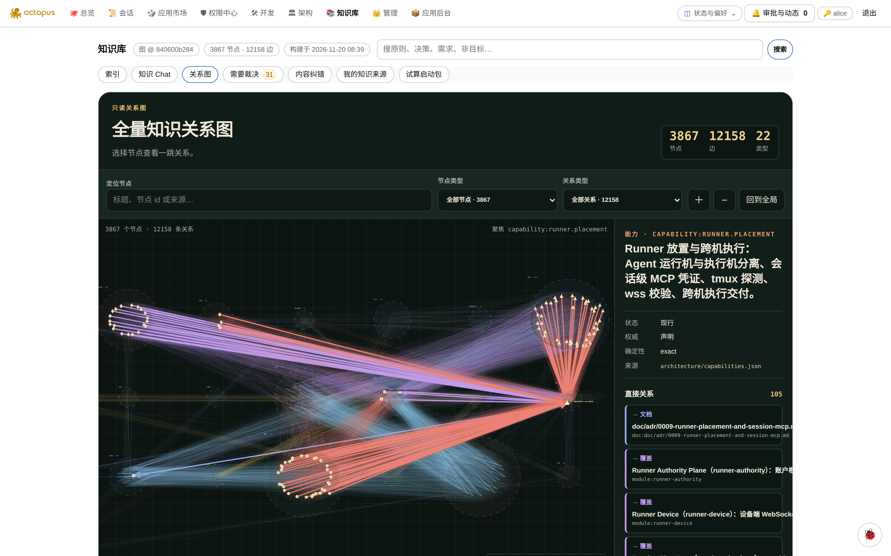
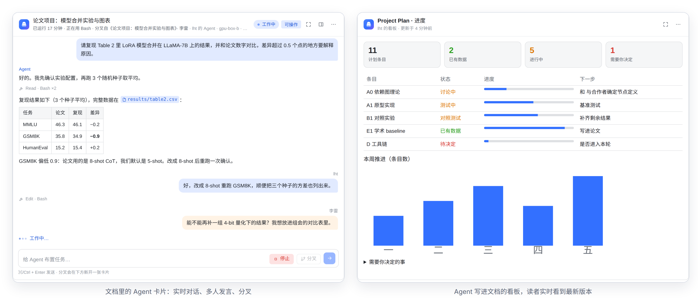
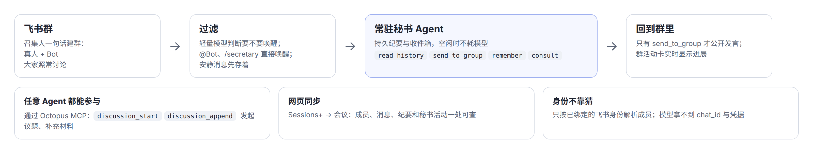

<p align="center"></p>

<p align="center"><b>A multi-user, distributed control plane for coding agents</b></p>

<p align="center"><b>English</b> · <a href="README.zh-CN.md">简体中文</a></p>

Bring every Claude Code, Codex and OMP session on all your machines into one place: watch, continue, file tickets and control access from anywhere.



## Architecture

One self-hosted control plane plus one Runner per machine. Runners dial out, so machines need no public IP.



## Highlights

### Every client

Web, phone, Feishu docs and a Windows console all open the same sessions. The UI ships in five languages.



### Distributed by design

A resident Runner on each machine discovers sessions, hosts agents, runs commands and moves files. The model can run on one machine while commands run on another.



### Multi-user

Everyone sees only their own devices and sessions. Sharing is always explicit: session links, doc-card speakers, tool grants.



### Claude Code · Codex · OMP

Three agents, one interface and one permission model: continue, fork, interrupt, switch model and effort.


### Take over tmux

Keep using your terminal. Octopus recognizes the CLI in tmux and lets you follow and reply from web or phone. It only types into an empty composer, so keystrokes never land elsewhere.


### Permissions

Grants can only narrow (Capability Kernel + Cedar). Each capability shows requested, granted and effective, with per-call approval when needed.



### Tickets & knowledge

Tickets go to an agent that develops in its own worktree, then lands and deploys. Octopus is built this way.


Every delivery feeds the knowledge base, built from code, ADRs and delivery records (full-text, vector and code index), which hands the next agent a context pack.



### Feishu Docs

Put a live agent inside a doc. Readers watch in real time and the owner talks to it; agents can also write the doc and draw boards.



### Feishu groups

Start a group in one sentence. A resident secretary follows the discussion and speaks only when needed.



## Quick start

```bash
pnpm install && pnpm -r build                    # Node 22, pnpm 9
cp config.yaml.example config.yaml               # enable the dashboard and runner sections
CONFIG_PATH=./config.yaml DATA_DIR=./data pnpm dev
```

Issue a device token on the Overview page and run the one-line installer on each machine. See `doc/runbooks/` for deployment and Runner details.

TypeScript · Node 22 · Fastify · React 19 · SQLite · Cedar · MCP

> Screenshots use demo data.

## License

[MIT](LICENSE)
