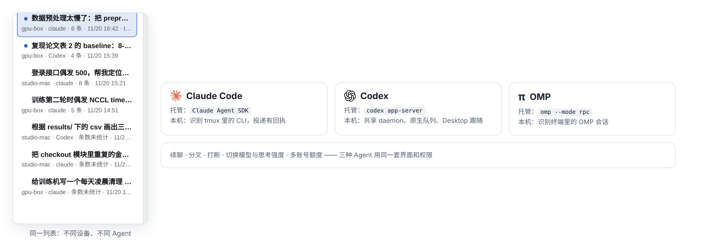
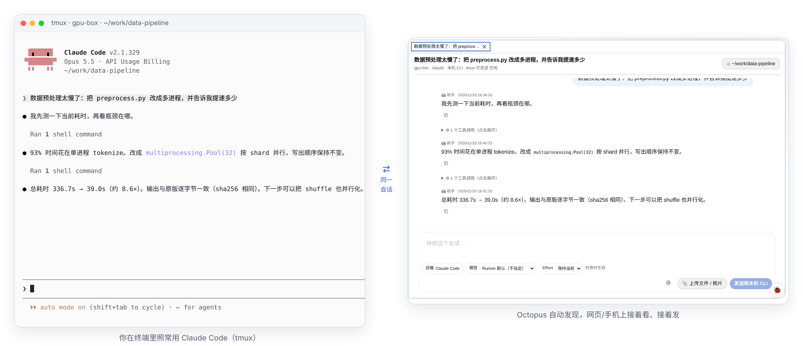
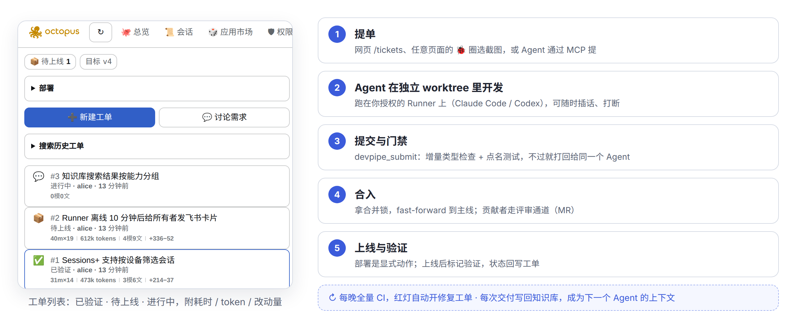

<p align="center"></p>

<p align="center"><b>多用户、分布式的 Coding Agent 控制平面</b><br>A multi-user, distributed control plane for coding agents</p>

把你和团队在各台机器上跑的 Claude Code、Codex、OMP 收到一处：随时随地看、接着聊、派工单、管权限。

Bring every Claude Code, Codex and OMP session on all your machines into one place: watch, continue, file tickets and control access from anywhere.


## 架构 · Architecture

一个自托管的控制平面，加上每台机器一个 Runner。Runner 主动外连，机器不需要公网 IP。

One self-hosted control plane plus one Runner per machine. Runners dial out, so machines need no public IP.


## 亮点 · Highlights

### 多端 · Every client

网页、手机、飞书文档、Windows 终端，打开的是同一批会话。界面有简体中文、繁體中文、English、日本語等 5 种语言。

Web, phone, Feishu docs and a Windows console all open the same sessions. The UI ships in five languages.


### 原生分布式 · Distributed by design

每台机器一个常驻 Runner：发现会话、托管 Agent、执行命令、互传文件。模型和命令可以分在两台机器上跑。

A resident Runner on each machine discovers sessions, hosts agents, runs commands and moves files. The model can run on one machine while commands run on another.


### 原生多用户 · Multi-user

每个人只看到自己的设备和会话。共享都是显式的：会话链接、文档卡片发言人、工具授权。

Everyone sees only their own devices and sessions. Sharing is always explicit: session links, doc-card speakers, tool grants.


### Claude Code · Codex · OMP

三种 Agent 用同一套界面和权限：续聊、分叉、打断、切换模型和思考强度。

Three agents, one interface and one permission model: continue, fork, interrupt, switch model and effort.



### 接管 tmux · Take over tmux

你在终端里照常用。Octopus 认出 tmux 里的 CLI，网页和手机上接着看、接着发；输入框不空时不投递，不会把字打进别的地方。

Keep using your terminal. Octopus recognizes the CLI in tmux and lets you follow and reply from web or phone. It only types into an empty composer, so keystrokes never land elsewhere.



### 权限 · Permissions

授权只会收窄（Capability Kernel + Cedar）。每项能力分「申请 / 已授权 / 此刻有效」三列，需要时逐次审批。

Grants can only narrow (Capability Kernel + Cedar). Each capability shows requested, granted and effective, with per-call approval when needed.


### 工单与知识库 · Tickets & knowledge

工单交给 Agent 在独立 worktree 里开发、合入、上线。Octopus 自己就是这样开发的。

Tickets go to an agent that develops in its own worktree, then lands and deploys. Octopus is built this way.



每次交付写回知识库。知识库从代码、ADR 和交付记录自动构建（全文、向量、代码索引），给下一个 Agent 一份上下文包。

Every delivery feeds the knowledge base, built from code, ADRs and delivery records (full-text, vector and code index), which hands the next agent a context pack.


### 飞书云文档 · Feishu Docs

把正在跑的 Agent 放进文档：读者实时看到，所有者直接对话；Agent 也能写正文、画看板。

Put a live agent inside a doc. Readers watch in real time and the owner talks to it; agents can also write the doc and draw boards.


### 飞书群 · Feishu groups

一句话拉群，常驻秘书跟进讨论，只在需要时发言。

Start a group in one sentence. A resident secretary follows the discussion and speaks only when needed.


## 快速开始 · Quick start

```bash
pnpm install && pnpm -r build                    # Node 22, pnpm 9
cp config.yaml.example config.yaml               # 打开 dashboard / runner 段 · enable the dashboard and runner sections
CONFIG_PATH=./config.yaml DATA_DIR=./data pnpm dev
```

在「总览」签发设备令牌，到每台机器上运行给出的一行安装命令。部署与 Runner 细节见 `doc/runbooks/`。

Issue a device token on the Overview page and run the one-line installer on each machine. See `doc/runbooks/` for deployment and Runner details.

TypeScript · Node 22 · Fastify · React 19 · SQLite · Cedar · MCP

> 截图均为演示数据。Screenshots use demo data.

## License

[MIT](LICENSE)
