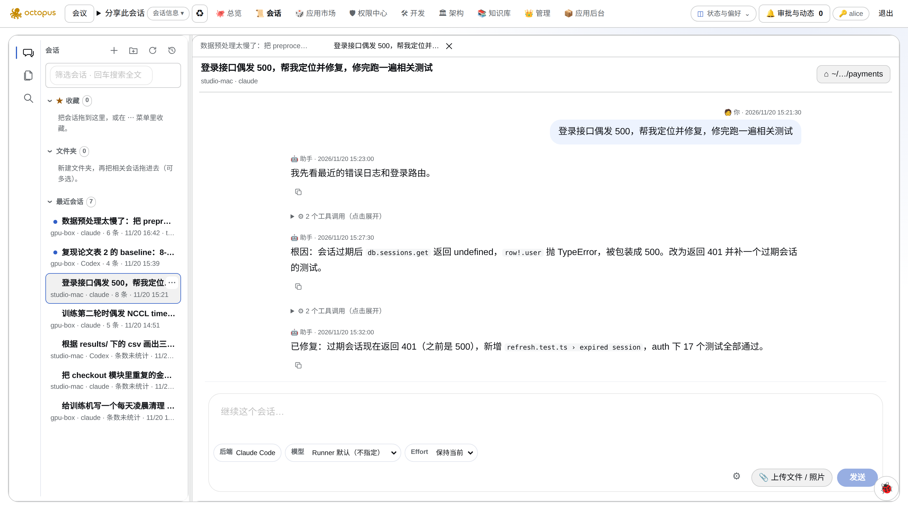
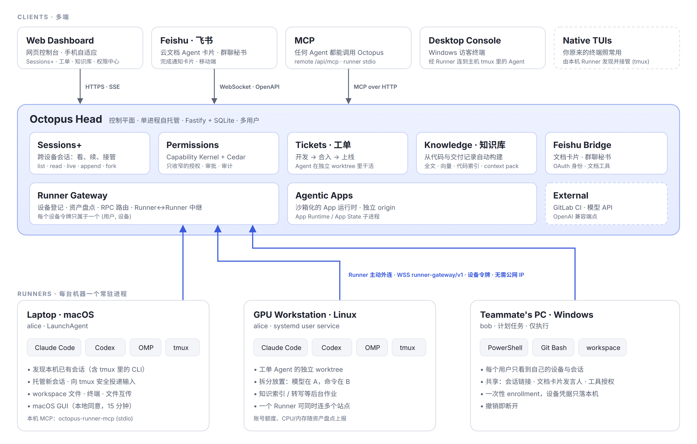
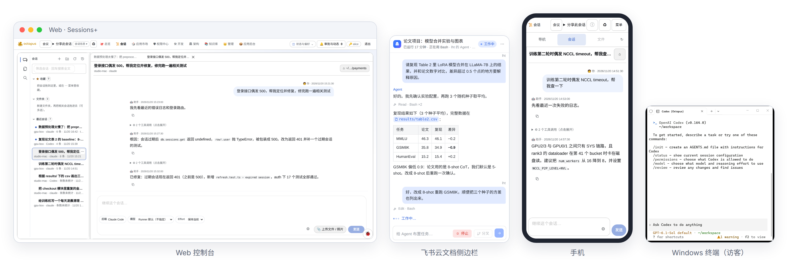
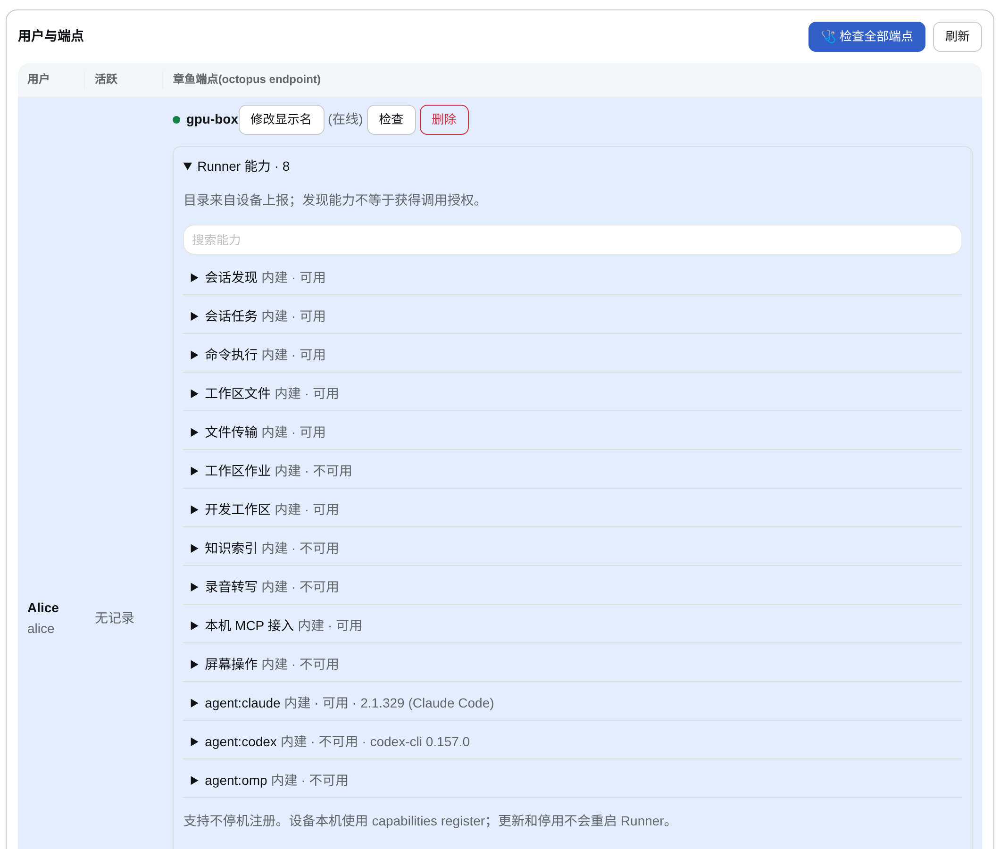
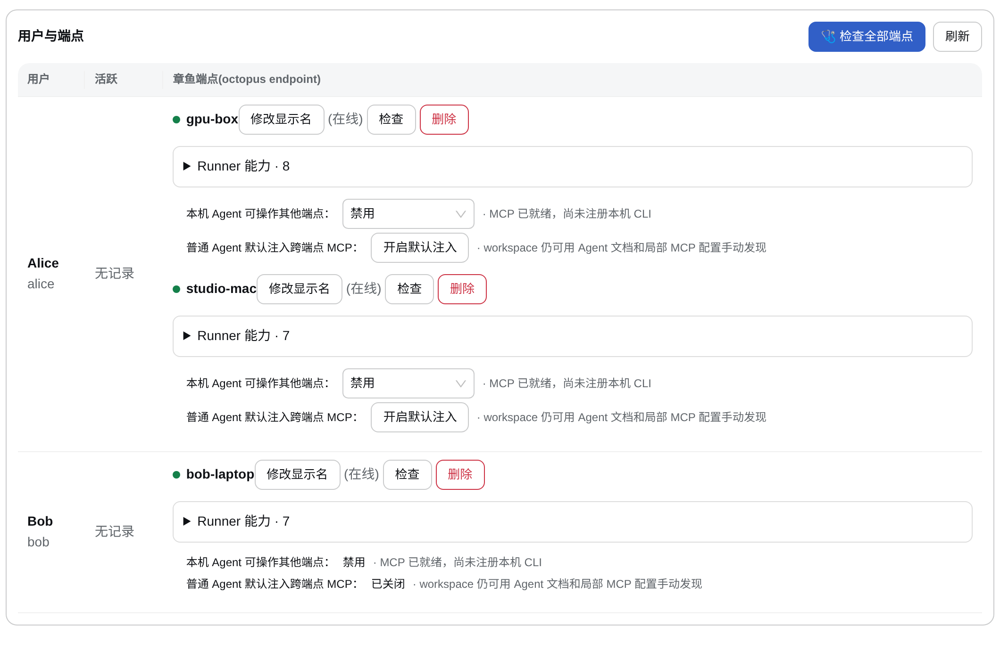
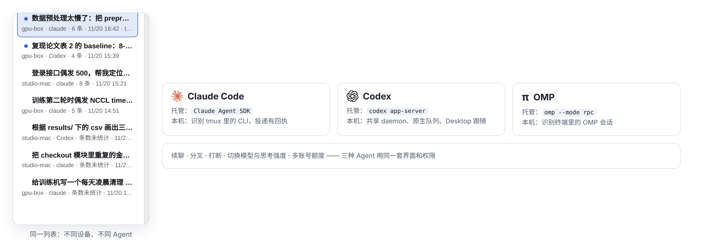
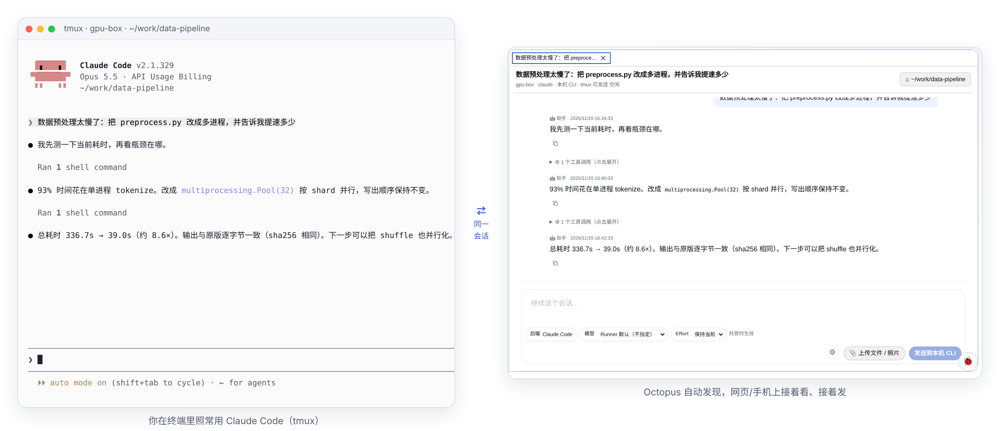
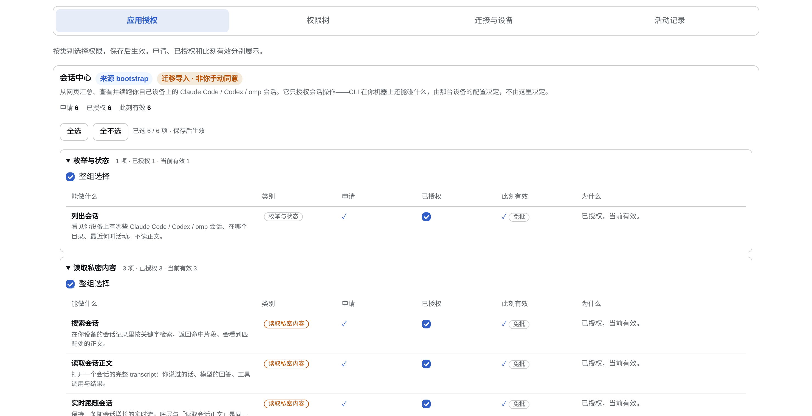
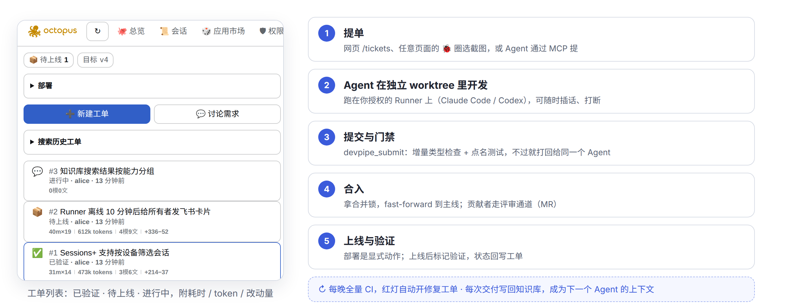
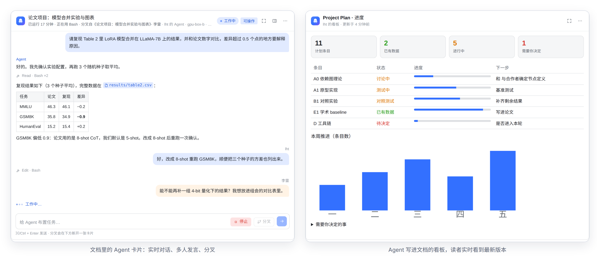

<p align="center"></p>

<p align="center"><b>多用户、分布式的 Coding Agent 控制平面</b></p>

<p align="center"><a href="README.md">English</a> · <b>简体中文</b></p>

把你和团队在各台机器上跑的 Claude Code、Codex、OMP 收到一处：随时随地看、接着聊、派工单、管权限。



## 架构

一个自托管的控制平面，加上每台机器一个 Runner。Runner 主动外连，机器不需要公网 IP。



## 亮点

### 多端

网页、手机、飞书文档、Windows 终端，打开的是同一批会话。界面有简体中文、繁體中文、English、日本語等 5 种语言。



### 原生分布式

每台机器一个常驻 Runner：发现会话、托管 Agent、执行命令、互传文件。模型和命令可以分在两台机器上跑。



### 原生多用户

每个人只看到自己的设备和会话。共享都是显式的：会话链接、文档卡片发言人、工具授权。



### Claude Code · Codex · OMP

三种 Agent 用同一套界面和权限：续聊、分叉、打断、切换模型和思考强度。



### 接管 tmux

你在终端里照常用。Octopus 认出 tmux 里的 CLI，网页和手机上接着看、接着发；输入框不空时不投递，不会把字打进别的地方。



### 权限

授权只会收窄（Capability Kernel + Cedar）。每项能力分「申请 / 已授权 / 此刻有效」三列，需要时逐次审批。



### 工单与知识库

工单交给 Agent 在独立 worktree 里开发、合入、上线。Octopus 自己就是这样开发的。



每次交付写回知识库。知识库从代码、ADR 和交付记录自动构建（全文、向量、代码索引），给下一个 Agent 一份上下文包。


### 飞书云文档

把正在跑的 Agent 放进文档：读者实时看到，所有者直接对话；Agent 也能写正文、画看板。



### 飞书群

一句话拉群，常驻秘书跟进讨论，只在需要时发言。


## 快速开始

```bash
pnpm install && pnpm -r build                    # Node 22, pnpm 9
cp config.yaml.example config.yaml               # 打开 dashboard / runner 段
CONFIG_PATH=./config.yaml DATA_DIR=./data pnpm dev
```

在「总览」签发设备令牌，到每台机器上运行给出的一行安装命令。部署与 Runner 细节见 `doc/runbooks/`。

TypeScript · Node 22 · Fastify · React 19 · SQLite · Cedar · MCP

> 截图均为演示数据。

## License

[MIT](LICENSE)
