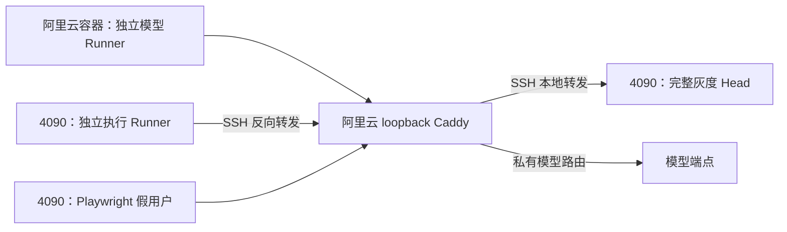

# 重构级 CLI 交付：完整灰度、再整体落地

状态：现行的重构验收路径；测试节点上的某个候选是否通过，必须看该候选的验收材料。
普通小修仍使用 [development-workflow](development-workflow.md)。本路径用于需要验证
完整 Head、Runner、App 与恢复语义的改动。灰度成功不替代既有 landing、部署和启动健康门。

## 交付顺序

1. 在独立 feature worktree 开发，从权威本地 `v4` 起步。参考主 worktree 始终只读。
2. 先枚举生产 composition、声明式 App、父 Agent 的工具调用和仅观察的会话；区分
   恢复所有者与授权对象。读知识上下文，把新发现补到就近文档和 curated knowledge。
3. 在 4090 建立独立完整 Head，使用新 SQLite、App State、假账号、假任务、独立 Runner。
   用 Git bundle 传输精确候选 SHA。每个 release 有自己的 node_modules 和 dist。
4. 运行必要测试和真实任务，按改动风险选择故障演练；保留失败与成功材料。
5. 读取权威 `v4` 最新版本，吸收并行落地并重新核对消费者。只有受影响的行为需补测，
   不因文档或验收脚本改动机械地重跑完整长时矩阵。
6. 完成实现与依赖审阅，按正常流程生成 CLI 报告，走 `land.sh` 的合并锁和 FF。
7. 按 `AGENTS.md`「Deployment is explicit」获得部署授权时走 `deploy.sh`，核对启动健康、水位、App 与 Runner 发布状态，
   把实际验证范围和待用户验收事项说清楚。

本次请求者最终明确采用上述正常交付路径，不要求额外静态门、完整长时矩阵或物料摘要
对账后才能上线。以下故障工具和晋级 manifest 是可选诊断工具，不替代判断，也不构成
每次 CLI 重构必须执行的清单。先收齐代码、依赖审阅与普通测试，再启动昂贵长时实验。

本次 Agent 重构的入口清单是 [managed-agent-consumers.json](../../architecture/managed-agent-consumers.json)，
故障覆盖要求是 [managed-agent-acceptance.json](../../architecture/managed-agent-acceptance.json)。
新增 agent 声明会让 inventory test 失败，应补清单并选择相应真实任务验证。

## 测试拓扑



所有 listener 只绑定 `127.0.0.1`。4090 无公网 IP 不妨碍运行 Head：使用已有受管
SSH 路径到达它，再设置双向转发。示例模板位于 `scripts/ops/refactor-lab/templates/`；
其中主机、端口、根目录是本次实例的示例，安装前必须核对空闲端口和实际 SSH 路径。

一台 Runner 可以同时接多个 Head，但不能用生产常驻 Runner 做破坏性断线测试。
候选 Runner 独立 scan home、Codex home、token、socket/runtime、recovery journal，
`control_site=primary`、`update_site=none`。生产 Runner 的控制站和更新站保持原配置。
多 Head 的实际进程测试另跑 `packages/runner/src/gateway-sites.integration.test.ts`：
动态加站、相同 RPC id 隔离、次站掉线及删除均不能中断主站。

## 创建与启动

在 Docker 主机用 `provision.py` 创建明确标记的空目录和 builder。它拒绝覆盖已有目录
或容器，固定镜像的实际 image ID，只共享内容寻址 pnpm store，不共享构建产物。
镜像需要 Node 22、pnpm、Python、Git 和 Playwright 浏览器。注意镜像可能同时装有
`/usr/bin/node` 与 `/usr/local/bin/node`；SQLite 的 ABI 必须与实际运行 Node 一致。

```sh
python3 scripts/ops/refactor-lab/provision.py \
  --root /srv/octopus-ci-ali/refactor-labs/managed-agent \
  --name managed-agent --image <已核对的镜像> \
  --origin-port 21820 --dashboard-port 21830 --runner-port 21910 \
  --pnpm-store /work/pnpm-store
```

把 feature 的 Git bundle 放进 lab 的 `artifacts/candidate.bundle`。运行 `lab.py seed`
会构建精确源码并通过正式 Store/UserManager 创建 `lab_alice` 和 `lab_bob`；拒绝已有
数据库、配置或凭据。`build` 只构建候选，不切换运行中的 Head。

```sh
python3 scripts/ops/refactor-lab/lab.py seed --root <lab根目录> --name managed-agent \
  --sha <完整40位实现SHA> --bundle candidate.bundle
```

`private/` 为 0700，token/config 为 0600。通过安全文件或管道补入测试模型路由及模型
凭据；不要打印 key，也不要复制生产数据库、聊天记录、MCP 配置或 hooks。配置必须
保持真实 channel/fleet 关闭，生产 run_dir 与 GitLab worker 不组合。部署脚本会检查这些边界。

私有连通链路：

- 阿里云 → 4090：转发灰度 Dashboard 与 Runner 网关到阿里云 loopback；反向把
  Caddy origin 转到 4090 loopback。Caddy 合并 HTTP/WebSocket 和 `/lab-model/` 模型路由。
- 模型容器 → 阿里云：专用 SSH 本地转发使容器里的相同 loopback origin 可达。
- 模型端点：可用独立 SSH 转发接入已有模型入口。独立 systemd unit 方便仅切断测试模型网络。
- 每条通道使用专用密钥，固定并验证 known_hosts；限制 authorized_keys 的
  permitopen/permitlisten。使用 `ExitOnForwardFailure`、15 秒 keepalive、3 次失败与服务重启。
  不关闭 host-key 检查，不把反向端口绑定 0.0.0.0。

准备 Runner：在 builder 用 `build-runner-seed.mjs` 打包 seed 工具，拷到 Runner 自己
的机器执行 `seed-runner`。模型端仅投影已有模型凭据到隔离 Codex home；执行端保持空
模型凭据。执行端仍需完整 Runner 模式，因为 `execution_only` 会关闭 Codex exec-server。
使用专用 Codex 二进制并在新 execution scan home 登记合成 Sessions workspace。

`model-runner.py` 验证专用 unit、lab identity、update_site=none 和候选 bundle 摘要，
仅停止该测试 Runner、原子替换 bundle 并恢复服务。参数与 `fault-native.py` 的显式机器/根目录相同。

`runner-process.mjs` 在模型容器跟踪准确 PID、Linux start time、UID 和 argv；停止时
不能按进程名杀全部 Codex。`runner-container.py` 只替换具有准确 lab ownership label 的
执行 Runner。更新两个 Runner 后记录实际 bundle SHA-256，必须等于候选构建产物。

```sh
python3 scripts/ops/refactor-lab/lab.py deploy --root <lab根目录> --name managed-agent \
  --sha <完整SHA> --bundle candidate.bundle
python3 scripts/ops/refactor-lab/runner-container.py --root <lab根目录> \
  --name managed-agent --sha <完整SHA>
```

部署先完成构建，再 drain 旧测试 Head。失败时保留旧 release 和独立状态供检查。
`deployment-<sha>.json` 的 `realAgentAcceptance=pending` 只表示进程健康。
在 builder 的 `/lab/releases/<sha>` 工作目录运行 `publish-apps.mjs /lab`，用正常
declare/install/activate API 激活候选 App。不要修改已提交 release 的源码或依赖链接。

需要工单验收时运行 `seed-ticket.mts /lab`，随后重新部署测试 Head。它创建无任何
remote 的私有工单 Git 仓库，只授权假用户在合成 workspace 操作，保留正常工单门，
不组合生产部署 worker。测试工单可以执行文件任务，不能误指向权威 v4。

## 真实验收与故障注入

所有 Node 驱动从当前候选 cwd 加载实现；外部调试版驱动必须另外记录 driver digest。
使用新的 case id；已有 receipt 不能覆盖成另一轮成功。驱动失败仍保留 `passed=false`。
App 验收先通过可信 activity 读取确认该 scope 空闲，绑定本次新建的 turn ID，并等待同一
turn 的终态；不能用任意旧任务的“已结束”或仅出现结果标题判定通过。模型故障注入前
先跑该检查，避免把排队的新输入错当成被停止的旧任务。`app-activity.mjs` 复用页面本来
发出的只读请求，不增加授权旁路。知识跨用户测试通过正常 admin grant 给 `lab_bob`
最小 dev 入口权限，先确认自己的列表可读，再断言别人的对话 404；页面级 403 不能替代它。

| 驱动 | 验证对象 |
|---|---|
| `accept-apps.mjs` | PPT 真正生成两页、Chess 真正落一次黑棋、科研秘书保存 briefing |
| `accept-keeper.mts` | 完整 AppPlane/State/Runtime inbox、真实模型收藏与账户隔离 |
| `accept-mcp-app.mjs` | 真实父 Agent 调用在线 Apps MCP；实例限权、撤销后拒绝 |
| `accept-discussion.mts` | 真实秘书/顾问、工具检查点后中断、关闭重开；外发仅捕获 |
| `fault-ticket.py` / `observe-ticket.mjs` | 正常工单 → split Agent → Head 重启 → 同一 operation/SID/实际文件；可选第二完整 Head 隔离 |
| `accept-research-session.mjs` | 科研项目正常授权、绑定 lead、追加原会话、实际文件 |
| `accept-mcp-session.mjs` / `native-page.mjs` | 真实父模型发消息、浏览器批准原 operation、原生工具确认和实际文件 |
| `accept-research-inbox.mts` | 科研 mcp 声明的 HTTP inbox，与外部 MCP actor 分别验证 |
| `accept-loop-fault.mts` | 已提交 App 动作后丢响应进入 unknown；真实模型后注入 429、显式新输入继续 |
| `accept-knowledge.mjs` / `fault-model.py --mode brief` | 10 秒私有隧道闪断、同一问题去重、原答案恢复及异用户隔离 |
| `fault-native.py` + `observe-native.mjs` | 停模型/执行 Runner，先恢复模型，超过一分钟查看真实 UI，再恢复或用户停止 |
| `fault-model.py` + `accept-app-wait.mjs` | 只停私有模型隧道，UI 从重连到等待，再自动完成或保留停止 |

`fault-native.py --wait-seconds 1835` 验证超过 30 分钟；`--revoke-while-waiting`
经正常用户 API 撤销当前执行 scope，检查 unknown 可见且环境回来不再执行。驱动从这个
合成 session 的私有 rollout 只提取原输入和恢复输入次数，不导出 prompt。

双完整 Head 的测试先用独立 root/端口/数据 seed 第二套 Head，再用 Runner `sites add`
热接入；主站保留 controls_machine，peer 不接管，两个站 update 均关闭。
`fault-ticket.py --peer-lab <name>` 在真工单进行时重启 peer，检查主 Head 和 Runner
进程未重启且主站在线，再重启主 Head 检查原 operation 完成。WebSocket mock 兼容测试
单独保留，不能替代这个测试。

长任务使用开始/完成标记；观察到开始标记且没有完成标记后才注入故障。人工注入太迟
导致任务先完成，不算断线通过。检查原 session lineage、原 operation/input ID、原输入
出现次数和副作用结果；“有文件”“模型说完成”“turn 状态 succeeded”单独都不证明需求完成。

两类故障不能混用：网络/可信 transport 不可达可以等待；capacity、撤权、工作区不存在、
协议不兼容和效果未知不应无限重试。未知效果用确实跨过派发屏障但没收到确认的实验验证，
不能把任意模型错误当作未知效果。用户 stop 后恢复网络也必须保持停止。

故障脚本的 finally 恢复其停止的测试服务；测试失败先核对这些服务状态，保留材料后排查。
同一个测试 Runner 上不要并行注入两个生命周期故障。HTTP 模型隧道与原生 Codex 端点
确实独立时，才可以分别注入。测试材料只保留合成任务，生产敏感信息不进 Git。

## 可选的严格晋级材料

在 artifacts 保存 `octopus-refactor-promotion/v1` manifest：`sha` 为精确实现 commit、
`baseSha` 为最终已吸收的权威 v4、`deployment` 为启动回执、`runners` 为两个在线端点的
候选 SHA/实际 bundle digest、`apps` 为实际激活的 App/digest，以及 `evidence` 列表。
每条 evidence 指定相对文件路径和 SHA-256。每个验收文件含 `sha`、`passed`、
`consumerIds`、`scenarios`、`realAgent`；检查记录另含 `kind=check`、`check` 和 `exitCode`。
不要给没有真实模型或没有实际结果的测试贴 `realAgent=true`。

```sh
python3 scripts/ops/refactor-lab/promotion.py --repo <精确实现checkout> \
  --manifest <promotion.json> --artifacts <artifacts目录> --base-sha <权威v4>
```

检查器拒绝缺少消费者、故障场景或测试，拒绝旧 SHA、改过的证据、pending/failed、
Runner 摘要不一致、缺 App 激活与主线前移。这个可选检查器采用严格提交身份；不适合把文档或脚本变化当作运行行为变化的场景。
正常交付只需把实际验证结果和可定位的材料路径写进 delivery 与 CLI 报告，按
[CLI 报告规范](../cli-reports/README.md) 生成最后的报告 commit。报告不能写“已上线”，
除非随后的生产部署与验收确实完成。

本地 `_land`/CI Runner 的完整检查、合并锁、FF、发布债务和生产启动检查全部保持原入口。
灰度流程不自行移动 v4、不拿长时间的合并锁、不触发生产 auto-update。

## 保留与回收

`lab.py status` 查看准确容器与候选；`lab.py stop` drain 这个 lab 的 Head。先保留
receipt、截图、测试日志、失败证据和必要的合成 DB，再停止独立 Runner、专用 tunnel/proxy
unit，撤销专用 SSH key。删除前逐个核对 ownership label 和绝对 lab 根目录。
不要用包含生产路径的通配符清理；不要因为一次验收结束就销毁仍供并行任务使用的节点。
