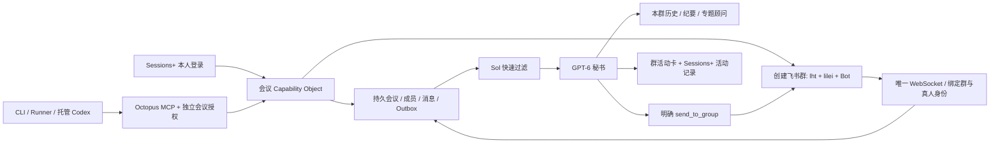

# 议题会议能力

一个议题对应一个由 lht 召集的飞书私有群，以及一个持久的秘书。真人在飞书讨论；同一会议的活动、纪要和最近消息可在 **Sessions+ → 会议** 查看，也可通过 Octopus MCP 创建、读取和追加消息。默认邀请示例是 lht 与 lilei；系统只按真实绑定解析用户名，不让模型猜测 open_id。

## 当前基础与设计取舍

旧 `Router`、群工具、secretary 仍在源码中，但当前 `bootstrap-v3.ts` 不构造这些服务。直接恢复旧入口会同时恢复其账号工具与会话调度边界。本模块改为复用当前 Capability Kernel / AccountAuthority、PermissionService、MCP surface、Store、`fetchLlm` 和 `app-agents/loop.ts`，并向现有飞书 WebSocket 增加一个按已登记群 ID 分发的接收器。

常驻意味着身份、收件箱、处理游标、纪要与活动持久存在；空闲时没有持续模型请求。秘书运行在 Bot 进程的独立工具循环中，不是一个原生 Codex CLI transcript。Sessions+ 的可信页面外壳增加会议入口，不把建群权限交给 App iframe，也不改变原生 CLI 会话的权限或转录格式。



## 消息与 Agent 机制

1. `discussion_start` 先解析召集人与参会者的唯一飞书身份，持久化建群意图，再调用 Bot 建群接口；lht 为群主，Bot 为管理员。一个 `(owner, request_id)` 只对应一个固定议题、名单和配置。相同参数重试返回原记录；换参数沿用 ID 会拒绝。
2. 新群首轮明确唤醒秘书开场。此后 Bot 回声、其他群及未登记成员的消息不进入会议。文本和富文本保留可读内容；附件保留占位，不下载；超长内容明确截断。飞书消息 ID 持久去重。
3. 普通消息先入库，再由 `gpt-5.6-sol / low` 判断 `wake`。安静消息保留，下一次秘书被唤醒时一起读。`/secretary`、明确 @ Bot、MCP/网页追加消息直接唤醒。过滤响应不合法或短暂失败时交秘书判断；不会丢弃该条消息。
4. `gpt-6-astra / high` 秘书每会议串行运行；忙时收到的消息进入下一轮。每轮最多读取 100 条、约 64K 字符的新材料，附带持久纪要、已处理历史摘录和最近秘书笔记；可分页查完整持久历史。Bot 默认最多同时运行 2 个秘书轮次。
5. 工具只有 `read_history`、`read_feishu_history`、`send_to_group`、`remember`、`consult`。目标群由服务绑定，模型不能传其他 chat_id、账号凭据或 shell 命令。工具循环默认不设上限（与 HQ 对话 #21 一致，可用 `maxToolTurns` 配置），每轮最多 3 次发言和 2 次顾问分析。顾问没有外部工具，可单独指定 model / effort / prompt，其活动与结果留档。
6. 模型普通输出是会议成员可见的工作笔记，只有 `send_to_group` 才公开发到飞书。秘书与当前顾问的工作状态更新同一张群活动卡；Sessions+ 显示各 Agent 的开始、工具、工作笔记、完成或失败事件，不展示隐藏思维链。

`discussion_append` 的语义是向秘书收件箱追加会议材料，不是冒充用户向飞书群发消息。秘书自行决定是否需要公开回复。

## 模型与提示词

部署默认配置见根目录 `config.yaml.example` 的 `discussions`；复用 `openai.base_url/api_key`。新会议可传 `settings` JSON 覆盖，既有会议由召集人在 Sessions+「模型与提示词」或 `discussion_configure` 修改。两个角色分别保存 model、effort、prompt，不把模型 ID 写死在调度层。

```json
{
  "filter": {
    "model": "gpt-5.6-sol",
    "effort": "low",
    "prompt": "判断是否需要秘书介入；输出 JSON：{\"wake\": boolean, \"reason\": string}。"
  },
  "secretary": {
    "model": "gpt-6-astra",
    "effort": "high",
    "prompt": "协助 lht 与 lilei。优先明确目标、证据、分歧和下一项可验证实验，避免每条消息都回复。"
  },
  "maxToolTurns": 0,
  "maxRepliesPerTurn": 3
}
```

这些模型名是本部署使用的可配置别名；实际端点必须支持选定 model/effort 和 Chat Completions 工具调用。修改中的配置带 `revision`，旧页面不能覆盖新配置；运行中换配置会中断并暂停，检查记录后显式继续。

## MCP 使用与授权

复用 `/api/mcp`，工具组为 `discussions`。新建 MCP token 的默认工具组包含它，Runner 的账号桥以及新签发的 Sessions+ 执行作用域也可暴露它；旧 token 保存的工具组不会被静默扩大，需要重新签发包含该组的 token。CLI 必须已连接 Octopus MCP，服务无法替未连接的任意 CLI 配置凭据。

| 工具 | 参数与用途 |
|---|---|
| `discussion_start` | `request_id`, `topic`, `participants`（Octopus 用户名，逗号分隔），可选 `agenda`, `settings` |
| `discussion_list` | 列出本人参与的最近 100 个会议 |
| `discussion_read` | `discussion_id`，可选消息游标 `after`；返回会议、消息与最近活动 |
| `discussion_append` | `discussion_id`, `request_id`, `text`；去重追加秘书收件箱 |
| `discussion_configure` | `discussion_id`, `revision`；可选 `settings`、`status: active/paused/closed` |

例如对已连接 MCP 的 agent 说：“以 lht 身份拉 lilei 讨论 Octopus 下一轮迭代，明确本周优先级并让秘书跟进。”它应使用 `discussion_start`，给这一意图一个稳定 request_id；遇到审批等待同一调用的结果，不另起一个建群意图。

工具组仅决定可发现范围；**还需要 MCP 服务主体的独立 operation grant**。默认召集人上限为 `discussions.owners: [lht]`。授予操作但不勾选 autoAllow 时走现有内核待批准流程，批准人必须是绑定账号本人；明确设置 autoAllow 后才可持续自动调用。普通参会者最多获得 list/read/append，不能管理别人的会议。payload 不能声明 owner 或 approved。浏览器操作需要本人登录与 CSRF，Bearer 不可走人工批准路径。

创建会议是一项明确的持续委托：秘书可在这个群内按上述工具行动，直到召集人暂停/结束或部署禁用该召集人。撤销 CLI token 或 MCP grant 会阻止新的 MCP 操作，并不自动解散它已创建的会议；要停止秘书，请暂停/结束会议。

会议参会名单在创建时固定，也是历史与进展的共享名单。后续手工拉入飞书群的人不会自动获得 Octopus 会议权限；手工退群不会删除原参与者已经获授的会议历史访问。需要改变议题共享范围时结束旧会议，再用明确的新名单创建新议题。

## 生命周期、故障与恢复

- `creating → active`：群创建确认；`creating → unknown`：调用结果不确定，或创建中进程退出。同一意图永不自动重建；核对飞书后可结束该记录。
- `active ↔ paused → closed`：暂停时新消息继续保存但无模型运行，关闭后停止接收。群不会因此被删除。召集人可在群内发送精确 `/meeting-pause`、`/meeting-resume`、`/meeting-close`。
- 每次公开发言先记 outbox，再 dispatch。收到回执才标 sent；发送结果未知会暂停会议，并在网页保留待核对文本，不自动重发。
- 重启保留 SQLite 消息、游标、配置、纪要和活动；空闲会议恢复处理。中断的秘书/顾问轮次暂停，避免重放已经发过言的轮次。原始收件箱不丢失；召集人检查记录再继续。
- 群卡更新失败留事件，网页仍能看到进展。飞书 HTTP 请求有 15 秒超时且不自动重试。服务关闭会 abort 模型工作并等待当前建群、发送和卡片工作结束。进程强制终止交由上述持久恢复规则处理。

## 上线前提与验收

启用 Runner/Capability Kernel、飞书 Bot 与可用模型端点。lht 和 lilei 均须注册并绑定唯一 Feishu `ou_` 身份。飞书应用需拥有建群及群管理、发送消息/卡片、更新卡片、读取群历史的权限；订阅 `im.message.receive_v1`，并获准接收群内所有消息。只有 @ Bot 的事件权限时，普通消息不会到达服务，无法实现完整的快速过滤。`bot_open_id` 可用于精确识别 @ Bot；未配置时仍可用 `/secretary`。

`channels.feishu.require_mention` 是旧聊天通道的配置。已登记的议题群始终按本模块的消息过滤规则处理，不受这个旧开关限制；未登记群不会进入秘书。

部署后由召集人实际创建测试议题，检查 lht/lilei/Bot 在群、普通消息被保存、明确请求唤醒、历史工具可用、卡片与 Sessions+ 进展一致、暂停停止模型与发言，再关闭测试会议。开发测试全部使用模拟外部接口，不会创建真实群或发送真实消息。

这次交付固化讨论与规划能力。专题顾问可分析科研方案，但没有自动领取工作区、运行实验或提交代码的权限；执行科研任务仍使用已有 Runner/工单授权流程，不能仅凭群聊内容继承参会者账号权限。

## 维护入口

- `service.ts`：调度、成员隔离、去重、停止与恢复。
- `capability.ts`：唯一操作定义、授权与批准凭据检查；MCP 和 HTTP 从同一 schema 派生。
- `model.ts` / `feishu.ts`：受信外部适配器；统一复用 `fetchLlm` 与 Lark SDK。
- `../store/repositories/discussions.ts` / migration v72：持久状态。
- `packages/dashboard-web/src/pages/session-plus/Discussions.tsx`：可信页面会议入口（仓库根目录相对路径）。

外部协议参考：[OpenAI Chat Completions](https://developers.openai.com/api/reference/resources/chat/subresources/completions/methods/create)、[飞书建群](https://open.feishu.cn/document/server-docs/group/chat/create)、[飞书发消息](https://open.feishu.cn/document/server-docs/im-v1/message/create)。SDK 参数以仓库锁定版本的类型声明为准。
